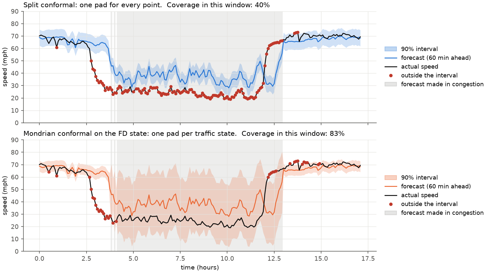
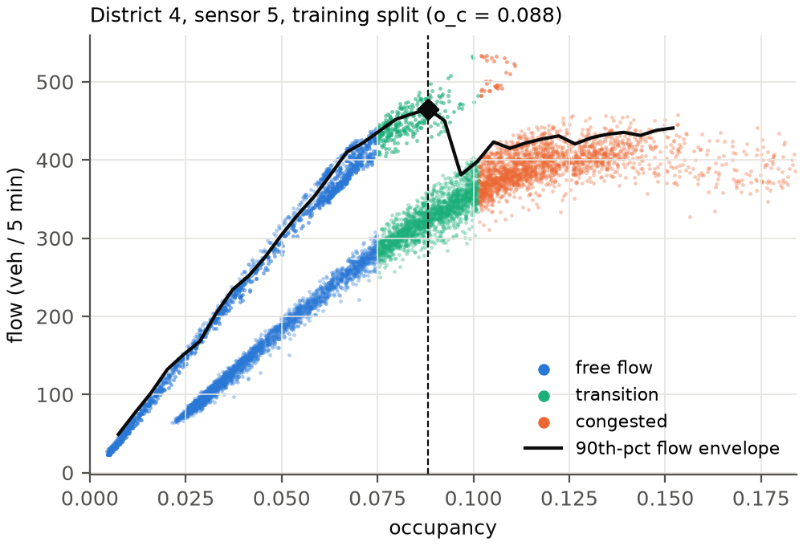
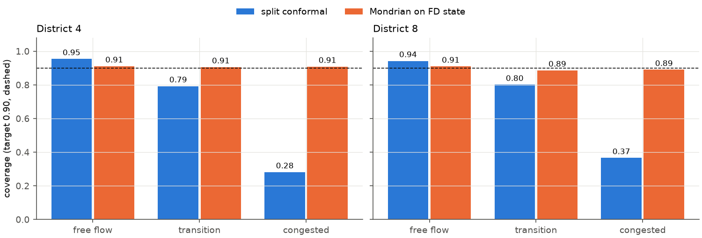
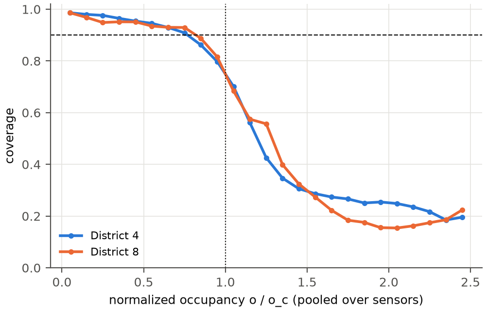
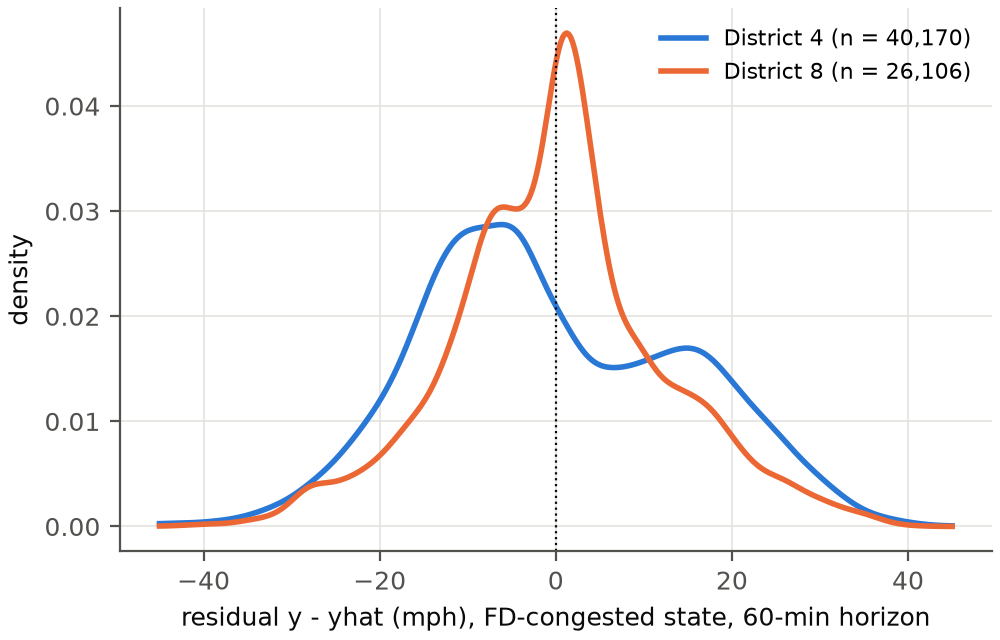
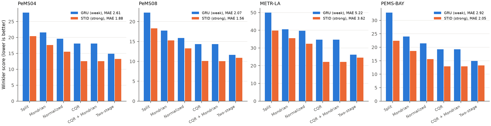

# Conformal prediction and the fundamental diagram in freeway speed forecasting

[](#the-paper)
[](requirements.txt)
[](The_Fundamental_Diagram_Localizes_Conformal_Prediction_Failure_in_Freeway_Speed_Forecasting.pdf)
[](#data)

This is the code, results and paper from a student project. The paper was accepted at
ISMT 2026. I wanted to learn conformal prediction properly, so I took one concrete question
and tried to answer it carefully:

> Split conformal prediction promises 90% coverage on average. Does a 90% interval around a
> 60-minute speed forecast still cover 90% of the time when traffic is congested?

On two Caltrans PeMS networks it does not. Coverage is 0.90 to 0.92 overall but 0.28 to 0.37
in congestion. This repo measures that gap, uses each sensor's fundamental diagram (FD) to
show where it opens up, and compares several standard ways of closing it.

<p align="center">
  
</p>

*One congestion episode at a District 4 sensor (test period, 60-minute-ahead forecasts). With
one pad for every point, the interval stays narrow and the actual speed falls outside it for
most of the congested period. Calibrating a separate pad for each traffic state widens the
interval when the forecast is made in congestion.*

None of the methods here are new. The aim was to understand them and to check them honestly
on real traffic data. The section "What is and is not new" says where each idea comes from.

## The paper

> S. N. Pratapani and S. R. Patlolla, "The Fundamental Diagram Localizes Conformal Prediction
> Failure in Freeway Speed Forecasting." Accepted at the 8th International Symposium on
> Multimodal Transportation (ISMT 2026), Singapore.

The PDF in this repo is the version that was submitted in September 2026. The forecaster in
this repo was later retrained from raw data with `code/train_gru.py`, so some numbers here
differ slightly from the PDF.

## Conformal prediction in short

A forecaster gives one number, for example "52 mph an hour from now". Conformal prediction
turns that into an interval, for example "45 to 59 mph", that should contain the true speed a
chosen fraction of the time, here 90%.

Split conformal, the simplest version, has four steps:

1. Train the forecaster on one part of the data.
2. On a separate calibration part, record how wrong it was at every point: the absolute
   residual |y - y_hat|.
3. Take the 90% quantile of those residuals (with a small finite-sample correction). Call it q.
4. For a new point, report the interval from y_hat - q to y_hat + q.

If the calibration points and the test points are exchangeable (roughly, they come from the
same distribution and their order does not matter), at least 90% of test intervals contain
the truth. This holds for any forecaster and any noise distribution, which is why the method
is popular.

The catch is the words "on average". The guarantee is marginal: it is about all test points
taken together. It says nothing about a particular kind of point. In this data about 9 in 10
points are free flow, where the forecaster is accurate, so q is set by easy points. In
congestion the errors are much larger and the same q is far too small. An interval can cover
90% of all points and only about 30% of congested ones, and the guarantee is still met.

Two more things worth knowing:

- Traffic data is a time series and the split here is chronological, so exchangeability does
  not strictly hold. In practice overall coverage still lands close to 0.90, but it is not
  guaranteed.
- Coverage and width are different things. A very wide interval always covers. So methods are
  compared on the Winkler (interval) score: the width, plus a penalty of 2/alpha times the
  distance by which the truth falls outside (alpha = 0.10 here). Lower is better.

The methods compared in this repo:

| Method | Idea | Source |
|---|---|---|
| Split conformal | one pad q for every point | Vovk et al. (2005), Lei et al. (2018) |
| Mondrian conformal | split the calibration points into groups and compute a separate q per group; gives 90% within each group, as long as the group is known at forecast time | Vovk et al. (2005) |
| Normalized conformal | divide residuals by a predicted error size, so intervals widen where the model expects to be wrong | Lei et al. (2018) and earlier |
| Conformalized quantile regression (CQR) | train the model to predict the 5% and 95% quantiles, then use conformal to correct them | Romano et al. (2019) |
| State-wise climatology | ignore the forecast; use the historical speed range seen in that traffic state | a baseline the reviewers asked for |

## The fundamental diagram in short

Each loop detector reports flow (vehicles per interval), occupancy (the fraction of time a
vehicle is over the detector) and speed. Plotting flow against occupancy gives the
fundamental diagram. Flow rises with occupancy up to a critical occupancy o_c, which is
roughly where the road reaches capacity, and falls after that as traffic jams.

I estimate o_c for each sensor from the training data and label every forecast origin as free
flow, transition or congested from its occupancy relative to o_c. The label only uses what is
known when the forecast is made, which matters for a fair evaluation (more on that below).

<p align="center">
  
</p>

*Flow against occupancy for one District 4 sensor (training data), coloured by FD state. The
diamond marks the estimated critical occupancy.*

## Main results

60-minute horizon, nominal coverage 0.90. Width is the mean interval width in mph. Winkler is
the interval score (lower is better). "Congested" is the FD-congested state, which is 3.9% of
test points on District 4 and 4.3% on District 8.

<p align="center">
  
</p>

*Coverage in each FD state. A single pad over-covers free flow and under-covers the other
two states. One pad per state brings all three close to 0.90.*

<p align="center">
  
</p>

*Coverage of the single-pad interval against occupancy divided by each sensor's critical
occupancy, pooled over sensors. Coverage drops as occupancy passes the critical point (dotted
line).*

District 4 (307 sensors, 1,039,809 test points)

| Method | Coverage | Congested coverage | Width | Winkler |
|---|---|---|---|---|
| Split conformal, one pad | 0.917 | 0.282 | 13.05 | 27.80 |
| Mondrian on FD state | 0.911 | 0.909 | 11.48 | 22.45 |
| Mondrian on origin speed | 0.912 | 0.876 | 11.13 | 21.21 |
| Normalized conformal | 0.908 | 0.939 | 10.85 | 19.06 |
| Conformalized quantile regression | 0.908 | 0.903 | 10.39 | 18.05 |
| State-wise climatology (no forecast) | 0.914 | 0.923 | 17.15 | 26.85 |

District 8 (170 sensors, 605,200 test points)

| Method | Coverage | Congested coverage | Width | Winkler |
|---|---|---|---|---|
| Split conformal, one pad | 0.902 | 0.366 | 9.11 | 22.26 |
| Mondrian on FD state | 0.906 | 0.890 | 9.52 | 18.51 |
| Mondrian on origin speed | 0.906 | 0.843 | 9.17 | 17.09 |
| Normalized conformal | 0.900 | 0.896 | 8.01 | 15.14 |
| Conformalized quantile regression | 0.905 | 0.869 | 8.05 | 14.34 |
| State-wise climatology (no forecast) | 0.900 | 0.902 | 14.36 | 22.98 |

Full output, including transition-state coverage and a few more baselines, is in
`results_v2/baselines.txt`.

What I take from these tables:

1. The average hides the failure. A single pad is set by the free-flow majority and is far too
   narrow once occupancy passes the critical point (`figures_v2/coverage_vs_occupancy.png`).
2. Conditioning on the FD state fixes congested coverage, which is what Mondrian calibration
   guarantees. It is not the most efficient fix. Normalized conformal reaches the same
   congested coverage with narrower intervals and is never told the FD state.
3. CQR has the best interval score on both networks, but it is not a complete fix. It
   undercovers the transition state (0.86 on District 4, 0.85 on District 8) and the
   congested state on District 8 (0.87).
4. In congestion, an interval built from the state's historical speed range alone scores about
   as well as the FD-conditional interval around the forecast (Winkler 56.9 against 59.2 on
   District 4, 53.0 against 53.3 on District 8). At a 60-minute horizon the GRU has little
   skill left once traffic has broken down.
5. Congested residuals on District 4 have two peaks, near -6 mph and near +15 mph. The first
   is congestion that persists, the second is a recovery the model did not predict
   (figure below).

<p align="center">
  
</p>

So the FD is useful here as a way to check an uncertainty method, more than as the thing to
calibrate on.

## What is and is not new

- Split and Mondrian conformal prediction are Vovk and coauthors' work. Normalized conformal
  and CQR are standard methods.
- Wang et al. (2026, arXiv:2606.18367) already report that conformal intervals for traffic
  forecasts undercover in congested and transition regimes, and that future speeds can be
  bimodal near transitions. They use foundation models and speed thresholds on the future
  window. This project defines states at the forecast origin from flow and occupancy.
- QuanTraffic (Wu et al., arXiv:2303.09273) already runs split conformal and CQR on PeMS04 and
  PeMS08 with stronger forecasters, reporting overall coverage. Petelin et al. (2024) also
  argue for CQR in traffic forecasting.
- What this repo adds is a careful, reproducible check on two networks: where the failure
  happens on the fundamental diagram, and how the standard fixes compare when judged state by
  state. It does not propose a new method.

## Later checks (not in the paper)

After the reviews I wanted to know whether the picture changes with a stronger forecaster and
on other data. These runs use STID (Shao et al., 2022), a stronger model than the GRU, and add
METR-LA and PEMS-BAY. Those two datasets have speed only, so states there are speed regimes at
the forecast origin (free flow at 55 mph or more, congested below 25 mph), not FD states.
Tables are in `results_summary/tables.md`.

<p align="center">
  
</p>

*Winkler score (lower is better) for each method on four datasets, with the GRU and with STID.*

- Split conformal still fails in congestion with the stronger model. Congested coverage is
  0.11 to 0.65 across the eight dataset and forecaster pairs.
- CQR with a separate correction per regime reaches 0.89 to 0.92 congested coverage on all
  eight pairs with almost no change in Winkler score.
- I tried a two-stage method (a second model on top of the point forecast). It beat CQR with
  the GRU (Winkler 14.90 against 18.05 on PeMS04), but lost to plain CQR with STID (13.25
  against 12.54). Its advantage came from making up for a weak forecaster, so I dropped it.
  The FD features in it added little once speed was already an input.
- A simple Laplace-mixture formula predicts split conformal coverage in each regime from the
  regime's error level, with a mean absolute gap of 0.040 over 24 values. It is a rule of
  thumb, not a theorem, and I have not checked properly whether it is already known.
- If regimes are defined by what happened in the future window instead of at the origin, no
  method reaches 0.90 on the "a transition happened" points, because that group is picked
  after seeing the outcome. This is the forecaster's dilemma (Lerch et al., 2017). It is why
  this project defines states at the origin. Details are in `results_audit/`.

These are exploratory. Each was run once per setting, and I have not written them up for
review.

## Layout

```
The_Fundamental_Diagram_...pdf  the paper as submitted (September 2026)
code/
  paths.py                  input and output folders (env vars switch between sets)
  conformal.py              split conformal, Mondrian, critical occupancy, FD state
  train_gru.py              trains the GRU on PeMS04 / PeMS08, writes predictions_v2/
  reproduce_tables.py       point error and coverage by state, cross-conditioning
  baselines.py              the method comparison above
  alignment.py              per-sensor breakdown points, raw vs normalized occupancy
  alignment_sensitivity.py  the same test over thresholds, bin counts and sensor subsets
  joint_mixture.py          joint FD x speed states and the mixture correction
  make_figures.py           figures in figures_v2/
  make_readme_figures.py    the example episode and coverage-by-state figures
  (the remaining scripts are the later checks: train_stid.py, train_gru_any.py,
   speed_regime_study.py, strong_forecaster_study.py, undercoverage_law.py, fd_informed*.py,
   pairs.py and the scripts that write results_audit/ and figures_audit/)
predictions_v2/             GRU forecasts and training logs used by the paper analysis
models/                     trained GRU weights for PeMS04 and PeMS08
results_v2/                 text output of each analysis script (paper analysis)
figures_v2/                 figures for the paper analysis
results_stid_gpu/, results_gru_gpu/, results_summary/, figures_summary/
                            later checks with STID and the extra datasets
results_audit/, figures_audit/
                            later checks on regime definitions, online calibration, bootstrap
predictions_stid_gpu/, predictions_gru_gpu/
                            training logs only; the forecast files are about 800 MB and are
                            not in the repo
```

## Running it

Python 3.11. The analysis needs the four packages in `requirements.txt`. Training also needs
PyTorch (CPU is enough for the GRU).

The GRU prediction files are in the repo, so the paper analysis runs without training:

```
pip install -r requirements.txt
python code/reproduce_tables.py > results_v2/reproduce_tables.txt
python code/baselines.py > results_v2/baselines.txt
python code/alignment.py > results_v2/alignment.txt
python code/alignment_sensitivity.py > results_v2/alignment_sensitivity.txt
python code/joint_mixture.py > results_v2/joint_mixture.txt
python code/make_figures.py
python code/make_readme_figures.py
```

The analysis is deterministic. Rerunning it on the files in `predictions_v2/` gives output
identical to `results_v2/`. It takes a few minutes on a laptop.

To start from raw data, put the two PeMS files in `Dataset/` (see below), delete
`predictions_v2/*.npz`, and run:

```
python code/train_gru.py --net pems04
python code/train_gru.py --net pems08
```

This took roughly two hours on my laptop CPU for both networks. Progress is saved after every
epoch, so an interrupted run continues when the same command is run again. Retraining uses a
fixed seed, but I have not checked that it gives bit-identical weights on another machine, so
expect small differences in the last digit.

The later checks need the STID and extra GRU forecasts, which are not included because of
their size. `code/train_stid.py` and `code/train_gru_any.py` produce them. I trained those on
a laptop GPU, and GPU runs are not bit-identical to CPU runs.

## Data

PEMS04 and PEMS08 (Caltrans PeMS Districts 4 and 8, 5-minute data, early 2018), in the `.npz`
form released with ASTGCN (Guo et al., 2019). Each file has one array `data` of shape
`[time, sensor, 3]` with channels flow, occupancy, speed. The raw files are not in this repo.
Training and the FD scatter plot need them at `Dataset/pems04.npz` and `Dataset/pems08.npz`.

METR-LA and PEMS-BAY (speed only) were taken from the processed versions in the
TorchSpatiotemporal `ProcessedDatasets` repository on Hugging Face and converted to the same
`.npz` layout. They are only used in the later checks.

The split is chronological: 60% train, 20% calibration, 20% test.

`predictions_v2/predictions_gru_<net>_h12.npz` holds what the analysis needs: `y`, `yhat`,
occupancy, sensor id and origin speed for the calibration and test splits, plus the critical
occupancy `o_c` of each sensor. Arrays are ordered by time and then by sensor.
`predictions_v2/quantile_gru_<net>_h12.npz` holds the 5% and 95% quantile forecasts.

## Method notes

- Forecaster: one-layer GRU with 64 hidden units. Input is the last 12 speed readings of a
  sensor (one hour), standardized with the training mean and standard deviation. Output is
  speed 60 minutes ahead. One set of weights per network, shared by all sensors.
- Training: Adam, learning rate 0.001, batch size 2048, squared error for the point model and
  pinball loss at 5% and 95% for the quantile model. The last 10% of the training period is
  held out for early stopping. Training stops when validation loss has not improved by at
  least 0.5% for two epochs in a row, or after 12 epochs, and keeps the weights from the last
  epoch that did improve by 0.5%. The runs here stopped after 6 to 10 epochs. Per-epoch
  validation losses are in `predictions_v2/training_log_*.json`.
- Test error of the point model: 2.61 mph on District 4, 2.07 mph on District 8 (mean
  absolute error).
- Critical occupancy: split occupancy into 40 equal bins between its 1st and 99th percentile,
  take the 90th percentile of flow in each bin with at least 20 points, and pick the bin where
  that is largest. Estimated on the training split only.
- FD state: free flow below 0.85 o_c, congested above 1.15 o_c, transition in between.
- Normalized conformal: a gradient boosting model predicts the absolute residual from origin
  speed, forecast and occupancy. It is fit on the first half of the calibration period and
  the conformal threshold comes from the second half.

## Known gaps

- The paper analysis uses one forecaster, one horizon and two networks from the same state.
  The later checks widen this a little but are not part of the paper.
- The GRU sees speed history only. A model that also sees occupancy or neighbouring sensors
  may behave differently in congestion. STID, in the later checks, also sees flow and
  occupancy on PeMS04 and PeMS08.
- Coverage numbers in the main tables come with no error bars. Points are correlated in time
  and across sensors, so a plain bootstrap would give intervals that are too narrow. A
  day-block bootstrap for the later checks is in `results_audit/block_bootstrap.txt`.
- Calibration to test drift is visible in a few small states, where Mondrian coverage lands
  at 0.87 to 0.88 instead of 0.90.

## References

- Vovk, Gammerman and Shafer (2005). Algorithmic Learning in a Random World. Springer.
- Lei, G'Sell, Rinaldo, Tibshirani and Wasserman (2018). Distribution-free predictive
  inference for regression. JASA.
- Romano, Patterson and Candes (2019). Conformalized quantile regression. NeurIPS.
- Angelopoulos and Bates (2023). Conformal prediction: a gentle introduction. Foundations and
  Trends in Machine Learning. A good place to start.
- Guo et al. (2019). ASTGCN, the source of the PEMS04 and PEMS08 files. AAAI.
- Shao et al. (2022). STID. CIKM. arXiv:2208.05233.
- Wu et al. QuanTraffic. arXiv:2303.09273.
- Petelin, Rozanec and Papa (2024). Traffic forecasting with uncertainty: a case for
  conformalized quantile regression. ECCOMAS Congress 2024.
- Wang et al. (2026). arXiv:2606.18367.
- Lerch, Thorarinsdottir, Ravazzolo and Gneiting (2017). Forecaster's dilemma: extreme events
  and forecast evaluation. Statistical Science.

## Contact

Sai Nishant Pratapani, Department of Civil Engineering, IIT Hyderabad. Please open an issue
on this repo for questions.
